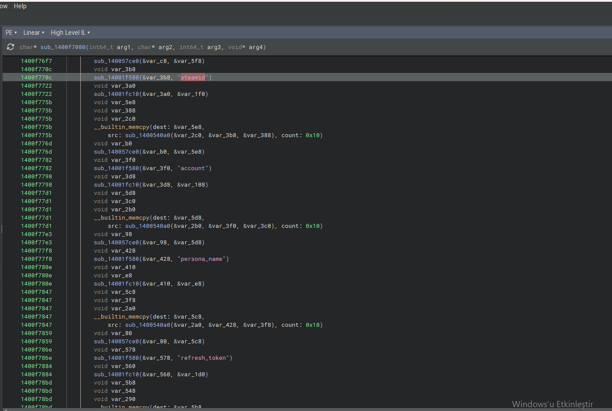
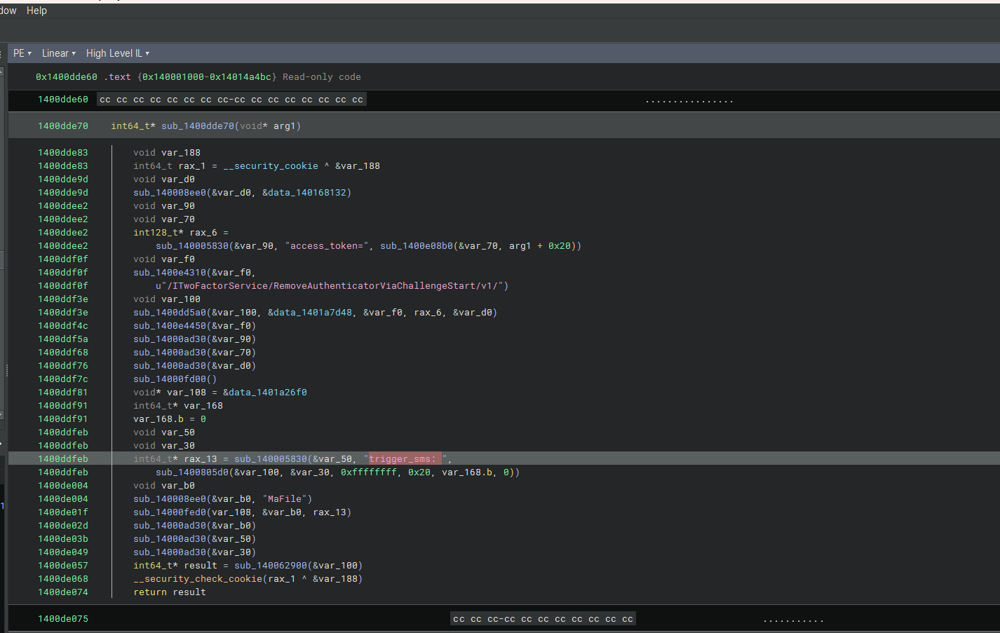
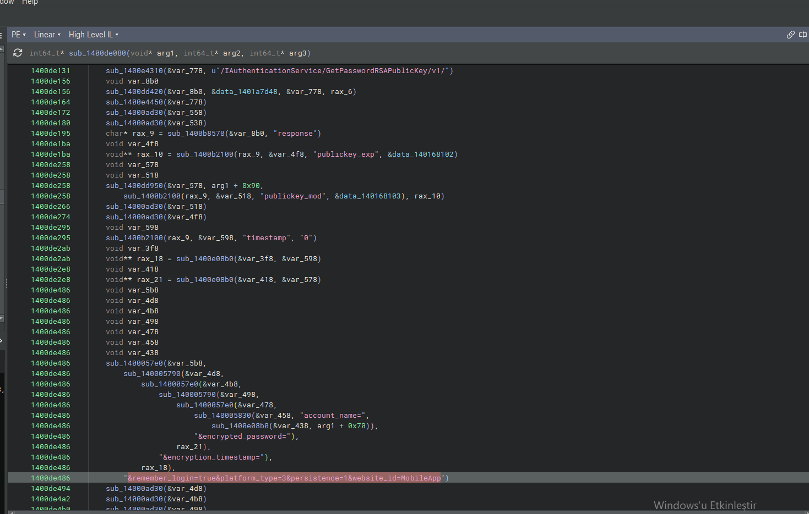
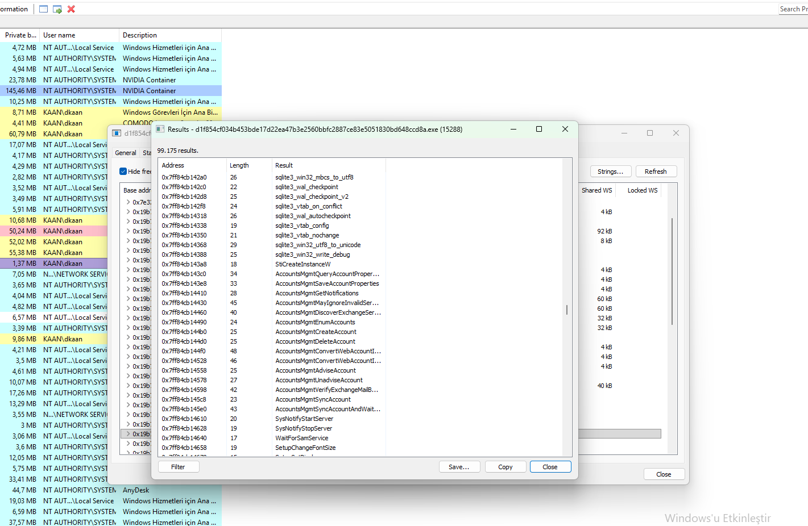
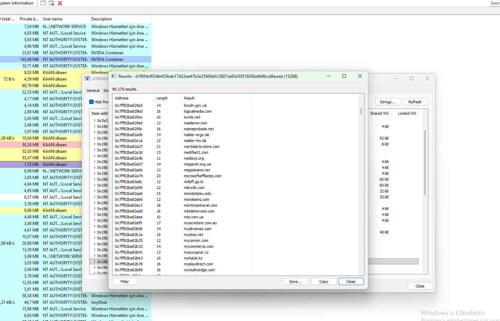

1. Steam Loader – Steam Account & Token Extraction
   
The initial reverse engineering of the Steam loader sample in Binary Ninja reveals a dedicated routine (sub_1400f7080) that locates and copies Steam account details. The decompiled High Level IL view clearly shows the malware resolving key account fields and copying their values into local memory. This confirms the loader targets active Steam account data and authentication tokens.

### Key Observations:

**Function**: sub_1400f7080 in Binary Ninja (High Level IL view) – extracts Steam account fields

**Account & Token Fields**: 

**sub_14001f580(&var_3b8, "steamid") – resolves the "steamid" identifier**.
**sub_14001f580(&var_3f0, "account") – resolves the "account" identifier**.
**sub_14001f580(&var_428, "persona_name") – resolves the "persona_name" identifier**.
**sub_14001f580(&var_578, "refresh_token") – resolves the "refresh_token" identifier**.

**Memory Copy Logic**:

**__builtin_memcpy(dest: &var_5e8, src: sub_1400540a0(...), count: 0x10) – copies steamid related data into memory**.
**__builtin_memcpy(dest: &var_5c8, src: sub_1400540a0(...), count: 0x10) – copies persona_name related data into memory**

### Why This Matters:

**Token & Session Theft**: Extracting "refresh_token" alongside "steamid" and "account" enables session hijacking without needing the password.
**Profile Identification**: Capturing "persona_name" and "steamid" identifies the victim's Steam profile and account value.
**Structured Extraction**: Explicit string keys ("steamid", "persona_name", "refresh_token") show targeted parsing rather than random memory reads.
**Static Detection**: Clear strings and memcpy blocks in sub_1400f7080 help identify related loader samples.

### Visual Reference:

2. Steam Loader – Two-Factor Authentication & SMS Challenge Logic

The static analysis of the Steam loader sample in Binary Ninja reveals a routine (sub_1400dde70) handling Steam two-factor authentication requests. The decompiled High Level IL view shows the function building an access token parameter and targeting an authenticator removal API endpoint. This confirms the loader interacts with Steam 2FA flows and processes SMS challenge or MaFile data.

### Key Observations:

**Token & Endpoint Logic**:

**sub_140005830(&var_90, "access_token=", sub_1400e08b0(&var_70, arg1 + 0x20)) – formats the "access_token=" parameter using token data from arg1 + 0x20**.
**sub_1400e4310(&var_f0, u"/ITwoFactorService/RemoveAuthenticatorViaChallengeStart/v1/") – prepares the Steam 2FA challenge endpoint path**.
**sub_1400dd5a0(&var_100, &data_1401a7d48, &var_f0, rax_6, &var_d0) – assembles the request using the endpoint, token string, and supporting data**.

**SMS & MaFile References**:

**sub_140005830(&var_50, "trigger_sms: ", ...) – formats a "trigger_sms: " status or prompt string**.
**sub_140008ee0(&var_b0, "MaFile") – references "MaFile" (Steam Desktop Authenticator mobile authenticator file)**.

### Why This Matters:

**2FA Bypass & Removal Flow**: Targeting /ITwoFactorService/RemoveAuthenticatorViaChallengeStart/v1/ with an access token directly relates to altering or removing Steam Guard two-factor protection.
**Mobile Authenticator Risk: References to "MaFile" and "trigger_sms: " indicate involvement with Steam authenticator secrets and verification challenges.**
**Token-Driven Requests: Passing "access_token=" shows requests depend on previously obtained authentication tokens.**
**Static Indicators: Endpoint strings and "trigger_sms: " / "MaFile" references inside sub_1400dde70 help spot similar Steam-focused loader routines.**

### Visual Reference:

3. Steam Loader – RSA Key Retrieval & Login Payload Construction

The static analysis of the Steam loader sample in Binary Ninja reveals a routine (sub_1400de080) that requests an RSA public key and builds a credential login payload. The decompiled High Level IL view shows the function parsing response fields and assembling URL-encoded authentication parameters.

### Key Observations:

**Function: sub_1400de080(void* arg1, int64_t* arg2, int64_t* arg3) in Binary Ninja (High Level IL view) – handles RSA key lookup and login payload assembly**.

**RSA Key & Response Parsing**:

**sub_1400e4310(&var_778, u"/IAuthenticationService/GetPasswordRSAPublicKey/v1/") – prepares the Steam RSA public key endpoint.**
**sub_1400b8570(&var_8b0, "response") and sub_1400b2100(...) – reads "response" and extracts "publickey_exp", "publickey_mod", and "timestamp"**
**sub_1400dd950(&var_578, arg1 + 0x90, ...) – processes credential data using the retrieved RSA exponent and modulus.**

**Login Payload Fields**:

**Builds parameters containing "account_name=", "&encrypted_password=", "&encryption_timestamp=", and "&remember_login=true&platform_type=3&persistence=1&website_id=MobileApp**"

### Why This Matters:

**Credential Encryption Flow**: Fetching "publickey_mod" and "publickey_exp" supports encrypting passwords prior to authentication requests.
**Mobile Session Mimicry**: Parameters such as "platform_type=3" and "website_id=MobileApp" mirror mobile client login requests.
**Account & Token Exposure**: Combining "account_name" with encrypted password fields indicates programmatic credential submission.

### Visual Reference:

4. Steam Loader – SQLite & Account Management Memory Strings

Dynamic memory inspection of the Steam loader sample in Process Hacker reveals embedded SQLite routines and Windows account management APIs in process memory. The string scan highlights database handling alongside account enumeration and modification functions.

### Key Observations:

**Sample & PID**: d1f854cf034b453bde17d22ea47b3e2560bbfc2887ce83e5051830bd648ccd8a.exe (PID 15288) scanned via Process Hacker memory strings.

**SQLite Database Strings**:

**sqlite3_wal_checkpoint, sqlite3_wal_checkpoint_v2, sqlite3_wal_autocheckpoint – WAL checkpoint and database state routines.**
**sqlite3_win32_mbcs_to_utf8, sqlite3_win32_utf8_to_unicode – character encoding conversions for database queries.**

**Account Management APIs**:

**AccountsMgmtEnumAccounts, AccountsMgmtQueryAccountProper..., AccountsMgmtSaveAccountProperties – account listing and property inspection/updates.**
**AccountsMgmtCreateAccount, AccountsMgmtDeleteAccount, AccountsMgmtSyncAccount – account creation, removal, and synchronization routines**

**System & Service Strings**:

**StiCreateInstanceW, SysNotifyStartServer, WaitForSamService – device, notification, and SAM service related references in memory.**

### Why This Matters:

**Database & Storage Access**: SQLite strings suggest parsing local databases such as browser or application stores.
**Account Enumeration & Manipulation**: AccountsMgmt* APIs indicate access to account metadata and management functions.
**Runtime Visibility**: Memory string scans expose loaded modules and APIs even when static imports are obscured.
**Behavioral Triage**: Pairing SQLite and account APIs helps prioritize dynamic monitoring of file and account activity.

### Visual Reference:

5. Steam Loader – Decoy C2 Domain Strings in Memory

Dynamic memory inspection of the Steam loader sample in Process Hacker reveals a large list of domain names present in process memory. Rather than acting as confirmed C2 infrastructure, these entries serve as noise or decoy strings that can mislead analysts during string scans.

### Key Observations:

**Sample Decoy Domains in Memory**:

**lincoln.gov.uk**, **mifaff.go.kr**, **minotstateu.edu** – unrelated government and education domains.
**microsoftaffiliates.com**, **mikrotik.com**, **mts.com.ua** – unrelated vendor and telecom domains.
**logicalmedia.com**, **mycommerce.com**, **myplaydirect.com** – unrelated commercial domains.

### Why This Matters:

**Analyst Misdirection**: Treating memory domain lists as C2 indicators without network correlation creates false leads.
**String Noise Filtering**: Large domain sets in memory complicate static and dynamic triage.
**Behavioral Verification**: Actual network traffic confirms real endpoints over residual memory strings.

### Visual Reference:

### Conclusion:

The static and dynamic analysis of the Steam loader sample highlights targeted account data handling, authentication/2FA request logic, stealer behaviors, and noisy memory strings across analyzed routines. Together, the decompiled views and runtime memory scans show how account identifiers, session tokens, authentication parameters, stealer behaviors, and decoy strings appear during inspection.

### Summary of Findings:

**Account & Token Extraction** (sub_1400f7080): References to "steamid", "account", "persona_name", and "refresh_token" with memcpy operations point to account and token parsing.
**2FA & SMS Logic** (sub_1400dde70): Presence of "access_token=", RemoveAuthenticatorViaChallengeStart/v1/, "trigger_sms: ", and "MaFile" relates to 2FA and authenticator workflows.
**RSA & Login Payload** (sub_1400de080): Use of GetPasswordRSAPublicKey/v1/, RSA key fields, and login parameters reflects credential and session setup.
**SQLite & Account Memory Strings**: Runtime memory strings in Process Hacker (d1f854cf034b453bde17d22ea47b3e2560bbfc2887ce83e5051830bd648ccd8a.exe, PID 15288) show sqlite3_* and AccountsMgmt* symbols.
**Decoy C2 Domains in Memory**: Unrelated domains in process memory act as noise rather than confirmed C2 servers.

### Overall Assessment:

The combined static and memory observations indicate a Steam-focused loader exhibiting stealer behaviors with structured account/token routines alongside distracting string noise. Correlating code behavior with verified runtime activity remains essential for accurate triage and defensive detection.

The analyzed Steam loader sample is available on MalwareBazaar for those who wish to conduct their own analysis:

[Steam Loader Sample on MalwareBazaar](https://bazaar.abuse.ch/sample/d1f854cf034b453bde17d22ea47b3e2560bbfc2887ce83e5051830bd648ccd8a)

**Tools Used:** "Binary Ninja , Process Hacker"
